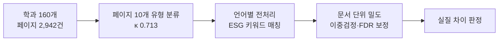
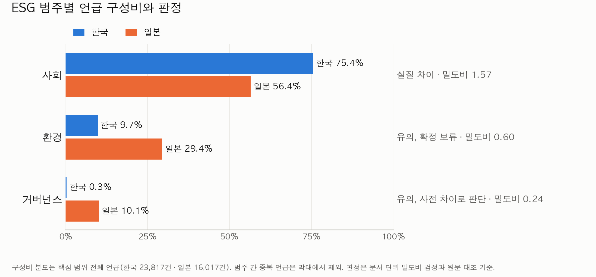

# 한일 가정학 계열 학과 홈페이지의 ESG 개념 비교: 텍스트 마이닝을 중심으로

## 프로젝트 배경

한국과 일본의 가정학 교육은 비슷한 출발점에서 각국의 교육제도에 따라 다른 방향으로 발전해 왔다. 대학 교육·연구에서도 ESG 논의가 확대되는 가운데, 본 연구는 지속가능성과 맞닿은 가정학 계열에서 관련 개념이 양국 간 어떤 차이를 보이는지 살펴보고자 했다. 이를 위해 두 나라 대학 홈페이지의 학과소개·교육과정·연구 페이지를 분석 대상으로 삼아 ESG 관련 언급을 비교하고 차이를 검정하였다.

> 한국 18개교 78개 학과 · 일본 18개교 82개 학과

| 분석 문서 | 비교 축 | 실질 차이 |
|---|---|---|
| 한국 1,172건 · 일본 821건 | ESG 범주 · 학과 · 페이지 유형 | ESG 범주 **사회 1개** · 학과 2개 · 페이지 유형 2개 |

「A Comparative Analysis of ESG Concepts in Home Economics Departments in Korea and Japan: Text Mining of Department Websites」 - 제2저자

## 분석 대상

* **분류:** 양국에 동일한 학과 계열 7개·페이지 유형 10개 기준 적용.
* **표 수치:** 전처리 후 커뮤니티·기타 유형을 제외한 최종 데이터 기준.

| 학과 계열 | 학과 수 (한국 / 일본) | 문서 수 (한국 / 일본) |
|---|---:|---:|
| 가정교육 (家政教育) | 11 / 7 | 119 / 35 |
| 생활과학 (生活科学) | 3 / 18 | 76 / 243 |
| 소비자 (消費者) | 4 / 1 | 100 / 3 |
| 식품영양 (食品栄養) | 25 / 29 | 340 / 276 |
| 아동가족 (児童家族) | 11 / 9 | 225 / 69 |
| 의류 (被服) | 19 / 11 | 263 / 104 |
| 주거 (住居) | 5 / 7 | 49 / 91 |
| **합계** | **78 / 82** | **1,172 / 821** |

| 페이지 유형 | 문서 수 (한국 / 일본) |
|---|---:|
| 학과소개 | 207 / 124 |
| 커리큘럼 | 271 / 167 |
| 교수·연구 | 294 / 147 |
| 학과활동 | 139 / 146 |
| 학생·졸업생활동 | 68 / 132 |
| 진로·취업 | 158 / 95 |
| 관련협회·기관 | 24 / 5 |
| 국제교류 | 11 / 5 |
| 커뮤니티·기타 (2개 유형) | 핵심 범위에서 제외 (486 / 96) |

## 분석 흐름

* **분류:** 수동 라벨 364건에서 페이지별 유사 사례를 찾아 few-shot 예시로 제공하고, gpt-4o-mini로 페이지 유형을 분류.
  * 약 절반은 직접 확인해 유형을 확정했고, 직접 라벨한 364건으로 leave-one-out 검증한 일치도는 Cohen's κ 0.713·정확도 75.0%.
* **매칭:** 한국어는 kss로 문장을 나누고, 일본어는 정규식으로 문장을 나눈 뒤 언어별 ESG 사전과 대조. 겹치는 표현은 가장 긴 표현을 우선.
* **검정 단위:** 페이지 수와 길이가 다른 양국의 언급 수를 직접 합산하지 않고 문서별 언급 밀도로 비교.
  * 국가 전체 빈도를 합산해 검정하면 언급 하나하나가 독립 표본처럼 세어져 작은 차이도 유의하게 나온다(Bestgen, 2017).
* **검정:** Mann-Whitney U(Mann & Whitney, 1947)와 Fisher-Pitman 순열검정(Pitman, 1937)을 함께 적용하고 FDR(Benjamini & Hochberg, 1995)로 보정.
  * 순위 기반 검정과 원값 기반 검정을 나란히 쓰는 설계는 Bestgen(2017)의 제안을 따름.
* **실질 차이 판정:** 두 검정이 모두 유의한지 확인하고, ESG 범주는 정규화 방식의 영향과 키워드가 실제로 그 범주를 가리키는지까지 원문과 대조.

## 결론

### ESG 범주: 사회 영역 서술은 한국이 더 많음

그림: 한국·일본의 ESG 범주별 언급 구성비와 범주별 판정 결과.

| 범주 | 밀도비 (한국/일본) | 판단과 근거 |
|---|---:|---|
| 사회 | 1.57 | **실질 차이** |
| 환경 | 0.60 | 유의하나 실질 차이로 단정하기 어려움: 문서 길이(정규화 분모) 차이가 주된 원인 |
| 거버넌스 | 0.24 | 유의하나 실질 차이로 보지 않음: 원문 맥락과 양국 사전 차이 |

> ※ 환경 밀도비는 오탐 우려 키워드(일본 管理栄養士·水, 한국 복지·행동)를 빼는 방식에 따라 0.45–0.81로 달라진다.
>
> ※ 구성비(범주 간 중복 언급 제외, 그래서 합이 100%가 아님): 사회 75.4% / 56.4%, 환경 9.7% / 29.4%, 거버넌스 0.3% / 10.1% (한국 / 일본).

* 밀도비는 검정에 쓴 문서 단위 평균 기준이며, 언급 수·밀도·검정은 모두 중복 범주 포함 기준.
  > ※ 코퍼스 합산 기준으로는 사회 1.33, 중복 범주를 제외한 사회는 1.20.

* **원문 대조:** 사회 범주 언급은 한국 21,343건, 일본 9,688건(2.2배)으로 원문 글자 수 차이(1.66배)보다 컸다. 환경 범주 언급은 한국 5,228건, 일본 5,268건으로 거의 같아, 환경 밀도비 0.60은 글자 수 차이에서 나온다.
  > ※ 중복 범주를 제외한 사회 언급은 17,968건 대 9,037건(1.99배)이다. 환경은 0.99배 ÷ 1.66배 ≈ 0.60.
* **서술 내용:** 상위 키워드는 양국 모두 교육이 1위. 그다음은 한국이 소비자·활동·개발, 일본이 活動(활동)·健康(건강)·参加(참여).
* **해석:** 한국 학과 홈페이지는 교육을 중심으로 소비자·활동·개발 같은 사회 영역 표현을 더 촘촘하게 씀.

### 학과: 가정교육은 한국, 식품영양은 일본의 밀도가 높음

| 학과 | ESG 전체 밀도비 (한국/일본) | 상위 키워드 (한국 / 일본) |
|---|---:|---|
| 가정교육 | 1.77 | 교육·개발·소비자 / 教育·法·実践 |
| 식품영양 | 0.56 | 교육·식량·관리 / 管理·健康·開発 |

* **가정교육:** 한국은 교육 비중이 특히 높음.
  > ※ 교육 TF-IDF는 한국 0.816, 일본 0.613
  * 다만 일본은 문서 35건 중 23건이 한 대학이고, 밀도 상위 5건이 모두 그 대학 문서다.
* **식품영양:** 일본은 管理(관리)의 평균 TF-IDF(0.339)가 教育(교육, 0.140)보다 2.4배 높음.
  * 자격명을 빼면 급식·식품의 위생·품질 관리와 건강 관리 문맥이 대부분으로, 인간의 건강을 중심으로 한 관리 표현으로 해석함.
    > ※ 管理 1,222건 중 약 68%는 국가자격명 管理栄養士와 학과·양성 교과목 이름에서 나왔다.
* **해석:** 학과 단위 차이는 이 두 계열에서만 확인됨.
  * 생활과학은 두 검정 모두 차이가 없었고, 아동가족·의류·주거는 두 검정의 결과가 엇갈려 판단을 보류함.

### 페이지 유형: 학과소개는 한국, 교수·연구는 일본의 밀도가 높음

| 페이지 유형 | ESG 전체 밀도비 (한국/일본) | 한국 문서 길이 · 언급 수 (일본 대비) |
|---|---:|---|
| 학과소개 | 1.33 | 0.76배 · 1.51배 |
| 교수·연구 | 0.65 | 1.26배 · 1.43배 |

* **학과소개:** 한국 문서는 일본보다 짧지만 언급은 더 많아, 밀도 격차를 문서 길이만으로 설명할 수 없음.
  * → 한국 학과는 대표 소개 글에 교육·환경·개발 같은 ESG 표현을 더 많이 담음.
* **교수·연구:** 언급 수는 한국이 더 많지만, 한국 문서가 평균 26% 길어 밀도는 일본이 높게 나옴.
  * "일본이 연구 페이지에서 ESG를 더 다룬다"는 밀도 기준에서만 성립하며, 양국 페이지 구성 차이가 함께 반영된 결과임.
* **해석:** 커리큘럼·학과활동·학생/졸업생활동·진로/취업 등 나머지 6개 유형은 두 검정 모두 차이가 없음.

## 거버넌스: 사전과 원문 맥락의 영향

* 일본 거버넌스 1위 키워드는 法(법), 2위는 協力(협력)이다. 法은 方法(방법)·指導法(지도법)에도 매칭됐고, 한국 사전에는 法이 포함되지 않았다.
* 양국에 공통된 협력/協力의 TF-IDF는 한국 0.028·일본 0.030으로 비슷했다. 사전 구성과 원문 맥락을 함께 고려해, 두 검정에서 유의한 밀도 격차를 실질적 서술 차이로 해석하지 않았다.

## 한계점 및 향후 과제

* **한계점:**
  * 대학 홈페이지 특성상 교육 키워드가 학과 일반 어휘와 겹칠 수 있어, 사회 범주 분해(교육의 학과 어휘 몫 분리) 검증이 필요하다.
  * 환경 격차에는 문서 길이·일반어 매칭이, 거버넌스 격차에는 양국 사전 구성·일본 일부 합성어의 오탐 가능성이 영향을 미쳐 실질 차이 판정에 제약이 있음.
  * 같은 대학·학과의 여러 페이지가 문구를 공유할 수 있지만 군집성을 모델링하지 않아, 문서 단위 검정의 유의성을 신중히 해석해야 함.
  * 일본 소비자 계열은 문서가 3건이라 검정에서 제외함.
  * 분류 정답 라벨은 분석자 1인이 작성해, κ 0.713은 모델과 1인의 일치도이며 코더 간 신뢰도는 검증하지 않음.

* **향후 과제:**
  * **모형 기반 재추정:** 문서별 언급 수를 글자 수 offset을 둔 음이항 회귀로 모형화해 국가·학과·페이지 유형의 상호작용을 한 모형에서 추정.
    * 대학·학과 임의효과로 군집성을 반영하고, 문서 수가 적은 조합은 위계 구조로 안정화해 현재 쌍별 검정 결과와 대조.
  * **사회 범주 분해:** 학과별 키워드 단위로 사회 범주 우세를 나눠, 교육처럼 학과 일반 어휘와 겹치는 몫과 실제 서술 경향의 몫을 구분.
  * **양국 사전 정렬:** 개념 단위로 대응시킨 공통 사전을 만들어 환경·거버넌스 격차를 다시 검증.
  * **분류 신뢰도:** 2인 이상이 정답 라벨을 작성해 코더 간 신뢰도를 확인.

## 수행 내용과 역할

| 단계 | 담당 | 교수진·협력자 |
|---|---|---|
| 수집·분류 | 최종 대학 선정, 한국·일본 대학 홈페이지 수집 목록 작성·검수, URL 지정·크롤링, 페이지 유형 분류·수동 검증 | 양국 학과 목록 제공 |
| 키워드·전처리 | 언어별 전처리·키워드 매칭 | ESG 키워드 목록 제공·일본어 표현 검수 |
| 분석·검정 | 문서별 밀도·이중검정 설계·분석 코드 작성, 원문·사전 대조와 결과 해석 | 연구 질문·비교 범위 설정 |

* **수행 기간:** 2026년 4월 한국 예비조사, 7–8월 한일 비교 본 분석

## 코드

Python · requests · Selenium · trafilatura · OpenAI API · kss · pandas · SciPy

| 경로 | 내용 |
|---|---|
| [code/notebooks/](code/notebooks/) | 페이지 유형·키워드·밀도 결과를 모아 확인하는 검토용 노트북 3개 |
| [code/crawling/](code/crawling/) | 수집·분류 코드와 단계별 실행·결과 확인용 `crawling.ipynb` |
| [code/analysis/](code/analysis/) | 전처리·빈도·연관·LDA 단계별 `.py`와 동명 `.ipynb`, 자동 실행·비교표 생성 코드 |

수집 원문·수동 검토가 반영된 최종 데이터셋·중간 산출물은 원문 재배포 문제로, 한국어·일본어 ESG 키워드 사전(JSON)은 연구진 자산이어서 포함하지 않음. 공개 분석 코드는 해당 최종 데이터셋을 입력받아 실행하며, OpenAI API 키는 보안상 제외함.

실행 환경과 필요한 입력은 [코드 안내](code/README.md)를 참고.
